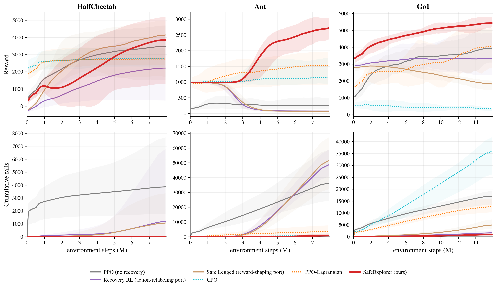
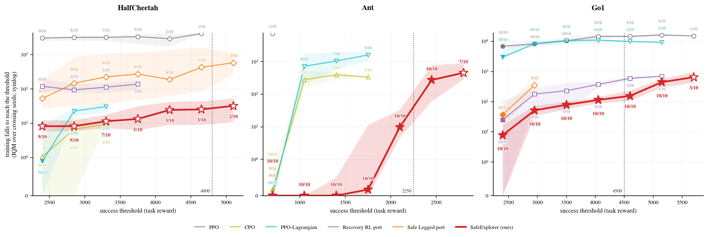

# SafeExplorer: An Unbiased Mixed-Policy Gradient for Reinforcement Learning with Recovery Interventions

Elham Daneshmand (McGill University, Mila); Majid Khadiv (Technical University of Munich); Glen Berseth (Université de Montréal, Mila); Hsiu-Chin Lin (McGill University, Mila)

Transactions on Machine Learning Research (TMLR), October 2026. ISSN 2835-8856. OpenReview: <https://openreview.net/forum?id=ppOrbSsMM0>. PDF: <https://openreview.net/pdf?id=ppOrbSsMM0>. Contact: elham.daneshmand@mail.mcgill.ca.

SafeExplorer changes PPO with a policy-gradient estimator that is unbiased for the mixed-policy return when a recovery policy takes over outside a safe region. In simulation it has at least an order of magnitude fewer training falls than PPO, at matching or higher reward.



Figure 1 (Figure 4 in the paper). Training reward and cumulative training falls, mean over 10 seeds with the min to max range shaded. SafeExplorer (red) ends training with 255×, 43× and 21× fewer falls than PPO (grey) on HalfCheetah, Ant and Unitree Go1, at matching or higher final reward.

## Abstract

Training agents directly on the task they will be deployed on often leads to the best policy performance, but training on physical robots can cause damage through falls, so minimizing training falls is critical. A standard mitigation hands control to a separate recovery policy whenever the agent leaves a designer-specified safe region. The resulting mixed-policy rollouts bias the on-policy update, and importance sampling cannot remove this bias when the recovery policy is deterministic.

We propose SafeExplorer, a drop-in modification of proximal policy optimization (PPO) built on an unbiased policy-gradient estimator of the mixed-policy return. The estimator uses the score function only inside the safe region and never evaluates the recovery policy's density, so deterministic recovery policies pose no problem. On final reward, the estimator matches or outperforms truncated importance sampling, which is itself biased for that same gradient. SafeExplorer also speeds up learning near the safe-region boundary with a closed-form critic target at recovery-triggering states when dynamics and recovery are deterministic, and an imitation loss that copies recovery actions only from successful recoveries.

On three simulated locomotion environments with ten seeds each, and given an already available recovery controller, SafeExplorer incurs 255×, 43×, and 21× fewer training falls than standard PPO on HalfCheetah, Ant, and Unitree Go1. SafeExplorer also matches or exceeds the final reward of PPO. On Ant, where 8.7% of recovery interventions end in a fall, over 40× the HalfCheetah rate, SafeExplorer reaches the success threshold on every seed and none of the five baselines reaches the threshold on any seed.

## Method

A recovery policy takes control whenever the agent leaves a designer-specified safe region, so training data come from a mixture of two controllers. PPO assumes its rollouts come from the policy being updated, so every update is biased toward the recovery policy's behavior. Importance sampling cannot remove this bias for a deterministic recovery policy, such as an MPC solver or a greedy SAC actor, because there is no action density to divide by.

Animated illustration on the page. Illustration, not data. The safe region grows over training with a linear curriculum. The main policy acts inside it, and whenever the state leaves it, the recovery policy steers the state back. Training rollouts therefore mix both controllers.

Masked policy gradient. Standard PPO computes a score term at every step, including steps where the recovery policy acted. SafeExplorer keeps the score term only at main-policy steps and never evaluates the recovery density. Advantages still run over the whole mixed trajectory, so recovery segments enter through the return.

### Masked policy gradient

The gradient of the mixed-policy return uses the main policy's score function only at steps where the main policy acts. The recovery policy never appears in it, so the recovery policy may be deterministic or stochastic.

$$
\nabla_\theta J^{\mathrm{mix}}(\theta) = \mathbb{E}_{\tau \sim p_\theta^{\mathrm{mix}}}\!\left[ \left(\sum_{t=1}^{T} \mathbf{1}[s_t \in \mathcal{M}]\,\nabla_\theta \log \pi_\theta(a_t \mid s_t)\right) r(\tau) \right]
$$

Here $\mathcal{M}$ is the set of states where the main policy acts (the safe region) and $r(\tau)$ is the discounted return of the trajectory. The theorem assumes a positive, differentiable main-policy log-density at main-policy steps, a finite horizon or bounded reward, and interchangeable differentiation and integration.

In PPO this amounts to averaging the clipped surrogate over safe steps only. For a stochastic recovery policy, per-step importance sampling is in general biased for this gradient, and we measure its gradient variance at up to 13 orders of magnitude above the masked one. Truncated importance sampling clipped at $c = 10$ loses 40% reward on Ant (details in Appendix E.16 of the paper).

*Theorem 1, paper Section 4.1, proof in Appendix A.1.*

### Objective-gap bound

Training optimizes the mixed-policy return, while the main policy alone earns the main-policy return. The two differ only where the main policy would leave the safe region.

$$
\left|J(\theta) - J^{\mathrm{mix}}(\theta)\right| \le \frac{2\,r_{\max}}{(1-\gamma)^2}\, \beta(\theta, d)
$$

Here $J$ is the main-policy return, $\beta(\theta, d)$ is the probability of being outside the safe region under the main policy's own discounted state visitation, and $r_{\max}$ bounds the per-step reward. Same assumptions as Theorem 1. If the safe region covers all reachable states, $\beta = 0$ and the two returns coincide.

We grow the safe-region radius linearly over training and track the recovery rate as a measured proxy for the gap. The measured gap closes to seed noise on HalfCheetah and Ant and stays at a residual on Go1, where recovery keeps firing. The bound is informative only when the out-of-region rate is small.

*Theorem 4 and Corollary 5, paper Section 4.2, proofs in Appendices A.2 and A.3.*

### Analytic recovery value

A learned critic bootstraps its targets through recovery segments, so its value targets stay wrong even with the masked gradient. With deterministic dynamics and recovery, the value of a recovery-triggering state has a closed form.

$$
V^{\pi^{\mathrm{mix}}_\theta}(s_t) = \begin{cases} G_{t,k} + \gamma^{k}\, V^{\pi^{\mathrm{mix}}_\theta}(s_{t+k}) & \text{success}, \\ G_{t,k} & \text{failure}, \end{cases} \qquad G_{t,k} = \sum_{j=0}^{k-1} \gamma^{j} r_{t+j}
$$

Assumes deterministic dynamics and a deterministic recovery policy. Here $s_t$ is a recovery-triggering state, $k \ge 1$ is the number of recovery steps until re-entry into the safe region at $t+k$ (success) or termination at $t+k-1$ (failure), and $G_{t,k}$ is the discounted return of the segment.

Recovery steps carry zero task reward in the rollout buffer, and a fall carries a one-time terminal reward $r_{\mathrm{term}}$, so $G_{t,k}$ is 0 on success and $\gamma^{k-1} r_{\mathrm{term}}$ on failure. We write this value into the buffer at every step of each recovery segment, with the re-entry value taken from the learned critic. Under stochastic dynamics it becomes a one-sample estimate.

*Proposition 6, paper Section 4.3, proof in Appendix A.4.*

### Outcome-gated compatibility regularizer

An update that is unbiased for the mixed-policy return does not teach the main policy to avoid states where recovery keeps failing. This auxiliary loss imitates the recovery actions, but only on recovery segments that returned to the safe region.

$$
\begin{aligned} \log C_\theta(\tau) &= \sum_{t \,:\, s_t \notin \mathcal{R}} \log \pi_\theta(a^{\mathrm{rec}}_t \mid s_t) \\ L^{\mathrm{compat}}(\theta) &= -\frac{\lambda_{\mathrm{compat}}}{N_{\mathrm{rec}}} \sum_{t \,:\, s_t \notin \mathcal{R}} \sigma_{\operatorname{seg}(t)}\, \log \pi_\theta(a^{\mathrm{rec}}_t \mid s_t) \end{aligned}
$$

The first line is the compatibility score of Definition 7, and the second is the outcome-gated loss built from it. Here $\mathcal{R}$ is the safe region, $a^{\mathrm{rec}}_t$ the recovery action and $N_{\mathrm{rec}}$ the number of recovery steps in the minibatch. The gate $\sigma$ is 1 when the recovery segment containing step $t$ re-entered the safe region and 0 otherwise, and a segment cut off by the end of the rollout counts as a tentative success. For a deterministic recovery policy with $\sigma \equiv 1$, the loss reduces to DAgger-style behavioral cloning.

The loss is a supervised term outside the unbiased gradient. It costs a little reward on HalfCheetah and adds +1036 and +2524 reward on Go1 and Ant over the variant without the regularizer (10-seed SafeExplorer against the 5-seed variant in Table 2).

*Definition 7, paper Section 4.4, special cases in Proposition 10 (Appendix A.6).*

### Algorithm

SafeExplorer changes a standard PPO loop in three places, the rollout's recovery branch, the value targets and the policy loss. The pseudocode follows Algorithm 1 of the paper.

```
for update u = 1 .. N:
    d = d0 + (u - 1) / N * d_max       # linear safe-region curriculum

    # rollout, T steps in each of E parallel environments
    if s_t in safe region R(d):  a_t ~ pi_theta(. | s_t)
    else:                        a_t = pi_rec(s_t);  is_rec_t = 1
    store s_t, a_t, r_t, log pi_theta(a_t | s_t), V(s_t)

    # analytic value, every step j of each recovery segment k
    # (segment starts at t_k, has length l_k, recovery rewards stored as 0)
    re-entry at t_k + l_k:   V(s_{t_k + j}) = gamma^(l_k - j) * V(s_{t_k + l_k})
    termination:             V(s_{t_k + j}) = gamma^(l_k - 1 - j) * r_term
    cut off by rollout end:  treat as re-entry at the rollout boundary

    A_t   = GAE on the overwritten values, over the full mixed trajectory
    R_t   = A_t + V(s_t)
    sig_k = 1 if segment k ended in re-entry, else 0

    for each epoch, for each minibatch:
        T_safe   = {t : is_rec_t = 0}
        L_ppo    = -mean_{t in T_safe} min(rho_t A_t, clip(rho_t) A_t)
        L_value  = mean_t (V_theta(s_t) - R_t)^2
        L_compat = -(lambda / N_rec) * sum_{t not in R} sig_seg(t)
                       * log pi_theta(a_t | s_t)
        minimize L_ppo + c_v L_value + L_compat - c_e H[pi_theta]
```

## Results

We compare SafeExplorer with PPO without recovery, on-policy ports of Recovery RL and Safe Legged that share its safe-region trigger and frozen SAC recovery policy, and the constrained RL solvers CPO and PPO-Lagrangian. We train for 8M environment steps on HalfCheetah and Ant and 16M on the 12-DoF Unitree Go1 quadruped, all in simulation, with 10 seeds per method.

Table 1. Final reward and total training falls, mean ± standard deviation over 10 seeds. All methods are scored on the same task reward, and rewards of recovery-using methods are training-time mixed-policy returns. Reward is the mean over the last 10% of training and falls are cumulative. CPO and PPO-Lagrangian run in OmniSafe at matched budget with a cost of 1 per fall and a cost limit of 0.05. Bold marks the best mean per column, except HalfCheetah falls, where the three lowest counts overlap and none is bolded.

| Method | HalfCheetah Reward ↑ | HalfCheetah Falls ↓ | Ant Reward ↑ | Ant Falls ↓ | Unitree Go1 Reward ↑ | Unitree Go1 Falls ↓ |
|---|---|---|---|---|---|---|
| PPO (no recovery) | 3462 ± 924 | 3899 ± 1573 | 259 ± 100 | 37600 ± 11202 | 3915 ± 603 | 17458 ± 1950 |
| Recovery RL (action-relabeling port) | 2209 ± 1404 | 1298 ± 2492 | 76 ± 14 | 51987 ± 7168 | 3332 ± 949 | 1753 ± 807 |
| Safe Legged (reward-shaping port) | **4117 ± 964** | 1135 ± 987 | 70 ± 14 | 55202 ± 9929 | 1838 ± 155 | 5410 ± 1228 |
| CPO | 2768 ± 343 | 17 ± 24 | 1153 ± 256 | **838 ± 152** | 364 ± 51 | 37364 ± 4787 |
| PPO-Lagrangian | 2743 ± 355 | 9 ± 16 | 1530 ± 368 | 3586 ± 2515 | 4018 ± 737 | 12859 ± 1649 |
| SafeExplorer (ours) | 3855 ± 958 | 15.3 ± 14.7 | **2698 ± 237** | 866 ± 718 | **5509 ± 155** | **830 ± 216** |

Fall reductions against PPO, with 95% bootstrap intervals, are 255× [148, 491] on HalfCheetah, 43× [27, 79] on Ant and 21× [18, 25] on Go1. On Go1, SafeExplorer has both the highest reward and the fewest falls in Table 1 and reaches the 4500 success bar on 10 of 10 seeds. Against CPO and PPO-Lagrangian, it has the highest reward of the three in every environment. Their fall counts are comparable to SafeExplorer's on HalfCheetah (17 ± 24 and 9 ± 16), and CPO's is comparable on Ant (838 ± 152), so the lead there is reward, for example 2698 ± 237 against 1153 ± 256 for CPO on Ant.



Figure 2 (Figure 1 in the paper). Training falls needed to reach each reward threshold. Each marker is the number of falls at the first persistent crossing of the threshold, as an interquartile mean over the k of n seeds that reach it (k/n printed, hollow when not every seed does), with 95% bootstrap bands on a symlog axis. Dotted lines mark the fixed success bars of 4800, 2250 and 4500. Lower is cheaper, and further right is more capable.

### Ant, with a deliberately imperfect recovery policy

We deliberately keep Ant's imperfect SAC recovery policy rather than retraining it, because recovery on real hardware also fails sometimes, and that is the regime where the outcome gate matters. In replays from one trained run per environment, it completes the recovery segment 70 to 91% of the time on Ant, against 97 to 100% on HalfCheetah and Go1. Recovery interventions on Ant end in falls 8.7% of the time, over 40× the HalfCheetah rate. PPO and the Recovery RL and Safe Legged ports all fail on Ant, with 38k to 55k falls and reward at most 259. SafeExplorer reaches the 2250 success bar on every seed. No baseline in Table 1 reaches it on any seed, and every variant without the hard outcome gate reaches it on at most 2 of 10 seeds. With the recovery branch disabled at evaluation, at the wider radius of the paper's Table 17, SafeExplorer keeps 3124 ± 358 reward at 90 ± 72 falls, against 299 ± 95 at 939 ± 23 for PPO.

### Ablation

We turn on one component at a time (Table 2). The unmasked policy gradient, the biased update that earlier recovery methods use, reaches competitive or higher reward on HalfCheetah and Go1. It also takes 11×, 5.2× and 3.4× more falls than SafeExplorer on HalfCheetah, Ant and Go1. Masking with a learned critic drops HalfCheetah reward to 1982, and the analytic value raises it to 3870 on the 5-seed ladder (2608 ± 1090 over 10 seeds). That gain does not carry over to evaluation with recovery disabled. The hard outcome gate is the only ladder variant that reaches the Ant success bar on every seed. The components interact, and the dominant one differs by environment.

Table 2. One component at a time (paper Table 10). Final reward and total training falls, mean ± standard deviation. The two middle rows use 5 seeds and the others 10. Bold marks the best value in the paper's full ablation table.

| Variant | HalfCheetah Reward | HalfCheetah Falls | Ant Reward | Ant Falls | Unitree Go1 Reward | Unitree Go1 Falls |
|---|---|---|---|---|---|---|
| Unmasked PG (10 seeds) | **4884 ± 305** | 165 ± 53 | 1364 ± 608 | 4505 ± 2184 | **6004 ± 459** | 2844 ± 461 |
| Masked, learned V (5 seeds) | 1982 ± 1058 | 306 ± 360 | 222 ± 275 | 50011 ± 30828 | 4374 ± 758 | 972 ± 206 |
| Masked, analytic V (no gate) (5 seeds) | 3870 ± 447 | 73 ± 19 | 174 ± 150 | 35481 ± 21851 | 4473 ± 628 | 926 ± 259 |
| SafeExplorer (hard outcome gate) (10 seeds) | 3855 ± 958 | **15.3 ± 14.7** | **2698 ± 237** | **866 ± 718** | 5509 ± 155 | **830 ± 216** |

## Limitations

All experiments are simulated locomotion, and fewer falls in simulation is no real-world safety guarantee. The results assume an existing recovery controller, a hand-designed distance that defines the safe region, and a per-environment maximum radius. If the falls spent pretraining the recovery policy are charged to a single training run, the reductions are 21.3× (HalfCheetah), 2.0× (Ant) and 2.8× (Go1), and they grow as the recovery checkpoint is reused. The recovery policy stays in use after training, and on Go1 it still fires at 16M steps. The analytic recovery value is exact only for deterministic dynamics and recovery. The objective-gap bound depends on an out-of-region rate that cannot be observed directly. A poor enough recovery controller can be worse than none.

## Other interventions

The masked-gradient theorem only needs the intervening controller to be independent of the policy parameters and to take over based on the state alone. It therefore also gives unbiased gradients of the mixed return for Jump-Start RL, where a fixed teacher acts until a handoff step (Corollary 8), and for shields that engage based on the state alone (Corollary 9). Action-triggered shields are outside the theorem.

## Rollouts

Final policies from seed 1, one deterministic episode each, with the recovery policy active as during training. An amber border marks the steps where the recovery policy acts.

- [HalfCheetah](static/videos/halfcheetah.mp4): HalfCheetah, first 20 s. Recovery does not act.
- [Ant](static/videos/ant.mp4): Ant, first 20 s. Recovery does not act.
- [Unitree Go1](static/videos/go1.mp4): Unitree Go1, the full 10 s episode. Recovery acts on 137 of 1000 steps. The robot tracks a sampled velocity command, so it moves mostly sideways.

## Citation

Elham Daneshmand, Majid Khadiv, Glen Berseth and Hsiu-Chin Lin. SafeExplorer: An Unbiased Mixed-Policy Gradient for Reinforcement Learning with Recovery Interventions. Transactions on Machine Learning Research, 2026.

```bibtex
@article{daneshmand2026safeexplorer,
  title   = {{SafeExplorer}: An Unbiased Mixed-Policy Gradient for Reinforcement Learning with Recovery Interventions},
  author  = {Daneshmand, Elham and Khadiv, Majid and Berseth, Glen and Lin, Hsiu-Chin},
  journal = {Transactions on Machine Learning Research},
  issn    = {2835-8856},
  year    = {2026},
  url     = {https://openreview.net/forum?id=ppOrbSsMM0}
}
```
